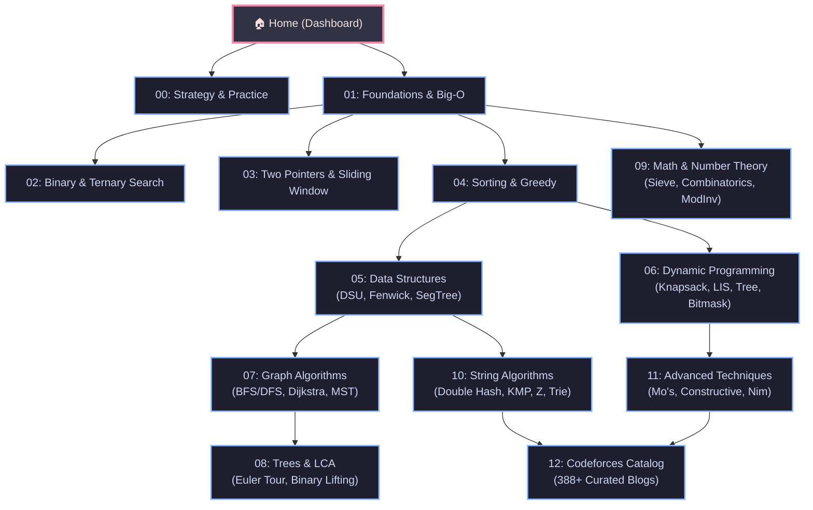

---
tags:
  - cp/dashboard
  - map-of-content
  - python
created: 2026-10-30
status: active
---

# 🏆 Competitive Programming in Python: Knowledge Base & MOC

> [!abstract] Welcome to your Obsidian Competitive Programming Hub!
> This vault is your structured, end-to-end curriculum for competitive programming from scratch in Python, mapped directly from the **[Codeforces Catalog](https://codeforces.com/catalog)**.
> 
> - 🗺️ **Visual Canvas:** Open [[ComProg/ComProg_Roadmap.canvas|Interactive Learning Roadmap]] for a panoramic node-by-node canvas view.
> - ⚡ **Contest Template:** Copy [[ComProg/template.py|Python Contest Fast I/O Starter]].
> - 🧪 **Test Runner:** Run `python3 run_tests.py <file.py>` on any solution file in the vault.

---

## 🧭 Visual Curriculum Graph

---

## 🗂️ Modules Directory (Maps of Content)

| Module | Core Topics | Python Templates | Catalog Reference |
|---|---|---|---|
| **[[ComProg/00_General_Advice_and_Practice/README\|00 General Advice & Strategy]]** | Mindset, Practice Protocol, Deliberate Training | [[ComProg/00_General_Advice_and_Practice/python_cp_guide.md\|Python CP Guide]], [[ComProg/00_General_Advice_and_Practice/codeforces_platform_guide.md\|Codeforces Platform Guide]] | [[ComProg/00_General_Advice_and_Practice/README#how-to-practice-effectively\|Practice Rules]] |
| **[[ComProg/01_Foundations_and_Complexity/README\|01 Foundations & Complexity]]** | Big-O in Python, Prefix Sums, Difference Arrays | [[ComProg/01_Foundations_and_Complexity/fast_io_and_templates.py\|Fast I/O]], [[ComProg/01_Foundations_and_Complexity/prefix_sums_and_diff_arrays.py\|Prefix Sums 1D/2D]], [[ComProg/01_Foundations_and_Complexity/practice_examples.py\|Kadane's]] | [[ComProg/12_Reference_and_Catalog/codeforces_catalog_full.md#general\|General]] |
| **[[ComProg/02_Binary_and_Ternary_Search/README\|02 Binary & Ternary Search]]** | Monotonic Invariants, Search on Answer, Unimodal Search | [[ComProg/02_Binary_and_Ternary_Search/binary_search_templates.py\|BS Templates]], [[ComProg/02_Binary_and_Ternary_Search/ternary_search.py\|Ternary Search]], [[ComProg/02_Binary_and_Ternary_Search/practice_problems.py\|Aggressive Cows]] | [[ComProg/12_Reference_and_Catalog/codeforces_catalog_full.md#binary-and-ternary-searches\|Binary Search]] |
| **[[ComProg/03_Two_Pointers_and_Sliding_Window/README\|03 Two Pointers & Sliding Window]]** | Inward Converging, Caterpillar, Fixed/Variable Window | [[ComProg/03_Two_Pointers_and_Sliding_Window/two_pointers_templates.py\|Two Pointers]], [[ComProg/03_Two_Pointers_and_Sliding_Window/sliding_window_templates.py\|Sliding Window]] | [[ComProg/12_Reference_and_Catalog/codeforces_catalog_full.md#two-pointers\|Two Pointers]] |
| **[[ComProg/04_Sorting_and_Greedy/README\|04 Sorting & Greedy]]** | Timsort, Custom Comparators, Exchange Arguments | [[ComProg/04_Sorting_and_Greedy/sorting_and_custom_keys.py\|Custom Sort & Coord Comp]], [[ComProg/04_Sorting_and_Greedy/greedy_templates.py\|Interval Scheduling]], [[ComProg/04_Sorting_and_Greedy/practice_problems.py\|Movie Festival]] | [[ComProg/12_Reference_and_Catalog/codeforces_catalog_full.md#greedy-algorithms\|Greedy]] |
| **[[ComProg/05_Data_Structures/README\|05 Data Structures]]** | DSU, Fenwick Tree, Iterative & Lazy SegTree, Monotonic Deque | [[ComProg/05_Data_Structures/dsu_disjoint_set_union.py\|DSU]], [[ComProg/05_Data_Structures/fenwick_tree.py\|Fenwick Tree]], [[ComProg/05_Data_Structures/segment_tree.py\|Segment Tree]], [[ComProg/05_Data_Structures/monotonic_stack_and_queue.py\|Monotonic Queue]], [[ComProg/05_Data_Structures/ordered_set_python.py\|Ordered Set (PBDS)]] | [[ComProg/12_Reference_and_Catalog/codeforces_catalog_full.md#data-structures\|Data Structures]] |
| **[[ComProg/06_Dynamic_Programming/README\|06 Dynamic Programming]]** | 1D/2D Tabulation, LIS $O(N \log N)$, Tree DP, Bitmasks | [[ComProg/06_Dynamic_Programming/01_knapsack_and_subsets.py\|0/1 Knapsack]], [[ComProg/06_Dynamic_Programming/grid_and_paths_dp.py\|Grid DP]], [[ComProg/06_Dynamic_Programming/lis_and_lcs.py\|LIS & LCS]], [[ComProg/06_Dynamic_Programming/interval_and_range_dp.py\|Interval DP]], [[ComProg/06_Dynamic_Programming/tree_dp.py\|Tree DP]], [[ComProg/06_Dynamic_Programming/bitmask_dp.py\|Bitmask DP]] | [[ComProg/12_Reference_and_Catalog/codeforces_catalog_full.md#dynamic-programming\|DP]] |
| **[[ComProg/07_Graph_Algorithms/README\|07 Graph Algorithms]]** | BFS, DFS, TopoSort, Dijkstra, Bellman-Ford, Kruskal MST, Bridges | [[ComProg/07_Graph_Algorithms/graph_traversal_bfs_dfs.py\|BFS & DFS]], [[ComProg/07_Graph_Algorithms/topological_sort.py\|Kahn's TopoSort]], [[ComProg/07_Graph_Algorithms/shortest_path_dijkstra.py\|Dijkstra]], [[ComProg/07_Graph_Algorithms/shortest_path_bellman_floyd.py\|Bellman & Floyd]], [[ComProg/07_Graph_Algorithms/minimum_spanning_tree.py\|Kruskal MST]], [[ComProg/07_Graph_Algorithms/bridges_and_articulation_points.py\|Tarjan Bridges]] | [[ComProg/12_Reference_and_Catalog/codeforces_catalog_full.md#graphs\|Graphs]] |
| **[[ComProg/08_Trees_and_LCA/README\|08 Trees & LCA]]** | Tree Flattening (Euler Tour), Binary Lifting $2^k$, LCA | [[ComProg/08_Trees_and_LCA/tree_basics_and_euler_tour.py\|Euler Tour]], [[ComProg/08_Trees_and_LCA/binary_lifting_lca.py\|Binary Lifting LCA]] | [[ComProg/12_Reference_and_Catalog/codeforces_catalog_full.md#trees\|Trees]] |
| **[[ComProg/09_Mathematics_and_Number_Theory/README\|09 Math & Number Theory]]** | Sieve, Smallest Prime Factor, $nCr \pmod P$, Extended GCD | [[ComProg/09_Mathematics_and_Number_Theory/primes_and_sieve.py\|Sieve & SPF]], [[ComProg/09_Mathematics_and_Number_Theory/modular_arithmetic_and_combinatorics.py\|Modular Math & Combinatorics]], [[ComProg/09_Mathematics_and_Number_Theory/gcd_extended_euclidean.py\|ExtGCD]], [[ComProg/09_Mathematics_and_Number_Theory/bitwise_operations.py\|Bitwise & XOR Basis]] | [[ComProg/12_Reference_and_Catalog/codeforces_catalog_full.md#mathematics\|Math]] |
| **[[ComProg/10_String_Algorithms/README\|10 String Algorithms]]** | Double Rolling Hash, KMP Prefix Function $\pi$, Z-Array, Trie | [[ComProg/10_String_Algorithms/polynomial_rolling_hash.py\|Double Rolling Hash]], [[ComProg/10_String_Algorithms/kmp_prefix_function.py\|KMP Search]], [[ComProg/10_String_Algorithms/z_algorithm.py\|Z-Algorithm]], [[ComProg/10_String_Algorithms/trie_prefix_tree.py\|String & Binary Trie]] | [[ComProg/12_Reference_and_Catalog/codeforces_catalog_full.md#strings\|Strings]] |
| **[[ComProg/11_Advanced_and_Niche_Techniques/README\|11 Advanced Techniques]]** | Constructive Problems, Mo's Algorithm, Game of Nim | [[ComProg/11_Advanced_and_Niche_Techniques/constructive_algorithms.py\|Constructive Patterns]], [[ComProg/11_Advanced_and_Niche_Techniques/mo_algorithm_and_sqrt_decomp.py\|Mo's Algorithm]], [[ComProg/11_Advanced_and_Niche_Techniques/game_theory_nim.py\|Game Theory Nim & Mex]] | [[ComProg/12_Reference_and_Catalog/codeforces_catalog_full.md#constructive-algorithms\|Constructive]] |
| **[[ComProg/12_Reference_and_Catalog/README\|12 Codeforces Catalog Archive]]** | Complete 388+ Indexed Blogs, Author Directory, Reading Order | [[ComProg/12_Reference_and_Catalog/codeforces_catalog_full.md\|Full 388+ Codeforces Catalog]] | [[ComProg/12_Reference_and_Catalog/README#the-essential-must-read-list-for-beginners\|Must-Read Guide]] |

---

## 🎯 Target Rating Milestones in Python

### Phase 1: 0 ➔ 1200 (Newbie to Pupil)
- **Primary Goal:** Flawless problem statement parsing and fast implementation.
- **Focus:** [[ComProg/01_Foundations_and_Complexity/README|Prefix Sums]], [[ComProg/02_Binary_and_Ternary_Search/README|Binary Search]], [[ComProg/03_Two_Pointers_and_Sliding_Window/README|Two Pointers]], [[ComProg/04_Sorting_and_Greedy/README|Greedy Choice]].
- **Contest Target:** Consistently solve Problems A, B, and C in Codeforces Div 3 and Div 4.

### Phase 2: 1200 ➔ 1400 (Pupil to Specialist)
- **Primary Goal:** Data structures and recursion control.
- **Focus:** [[ComProg/05_Data_Structures/README|DSU]], [[ComProg/05_Data_Structures/README|Fenwick Tree]], [[ComProg/07_Graph_Algorithms/README|BFS/DFS]], [[ComProg/07_Graph_Algorithms/README|Dijkstra]], [[ComProg/06_Dynamic_Programming/README|1D/2D DP (Knapsack, LIS)]], [[ComProg/09_Mathematics_and_Number_Theory/README|Sieve & Modulo Inverse]].
- **Contest Target:** Consistently solve Div 3 (A–E) and Div 2 (A–B).

### Phase 3: 1400 ➔ 1600 (Specialist to Expert)
- **Primary Goal:** Advanced data structures, trees, and optimization.
- **Focus:** [[ComProg/05_Data_Structures/README|Iterative & Lazy Segment Tree]], [[ComProg/08_Trees_and_LCA/README|Euler Tour & Binary Lifting LCA]], [[ComProg/06_Dynamic_Programming/README|Tree DP & Bitmask DP]], [[ComProg/10_String_Algorithms/README|Double Rolling Hash]], [[ComProg/09_Mathematics_and_Number_Theory/README|Combinatorics $nCr$]].
- **Contest Target:** Consistently solve Div 2 (C–D).

---

## ⚡ Python Pro-Tips Callout

> [!tip] Golden Rule: Always submit in PyPy 3 on Codeforces!
> - PyPy 3 is up to **10× faster** on loops than standard CPython.
> - Always import and configure `sys.setrecursionlimit(300000)` before deep DFS.
> - Never use `x in list` inside a loop ($O(N)$) — use a `set` or `dict` ($O(1)$).
> - Use `sys.stdin.read().split()` to read all inputs at once.

---

> [!bookmark] Quick Links
> - 📄 [[ComProg/README|GitHub Repository README]]
> - 📄 [[ComProg/12_Reference_and_Catalog/codeforces_catalog_full.md|Complete Codeforces Catalog (All Topics)]]
> - 🗺️ [[ComProg/ComProg_Roadmap.canvas|Open Interactive Canvas View]]
